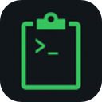
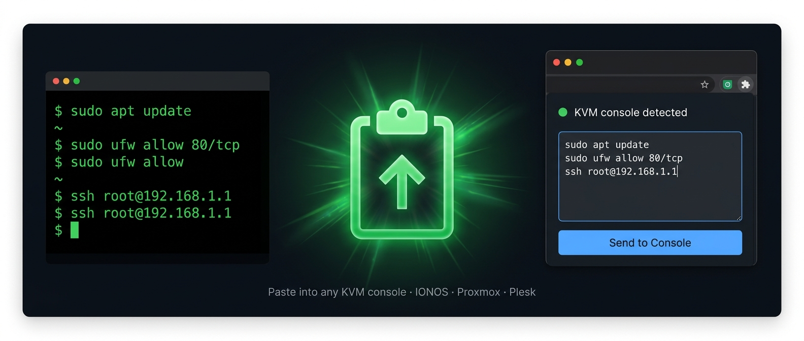
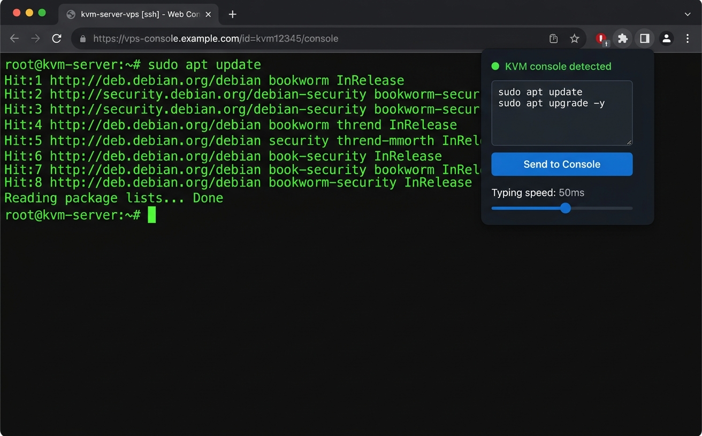
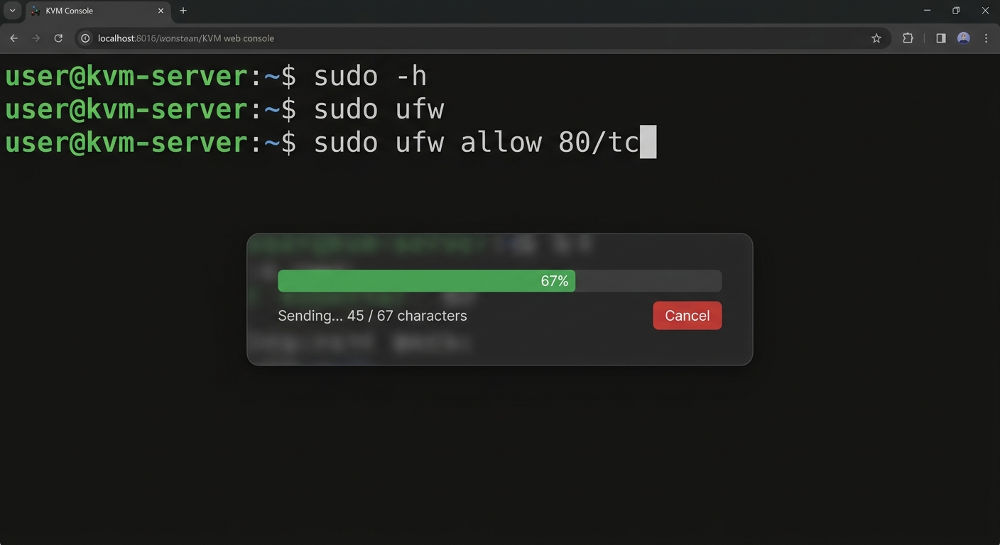

<div align="center">



# KVM Console Paste

**Paste into your KVM console. Finally.**
A free Chrome extension that pastes text into web KVM consoles built on noVNC (IONOS, Proxmox VE, Plesk…) by typing it for you, key by key.

[](https://chromewebstore.google.com/detail/kvm-console-paste/acogolacfpbgbddopekjchlckaggmjkd)
[](manifest.json)
[](LICENSE)
[](#-contributing)



**811 users · rated 5.0 on the Chrome Web Store** <sub>(November 2026)</sub>

</div>

---

## 😩 The problem

Web KVM consoles don't accept paste. The noVNC client draws the remote screen on a canvas, so <kbd>Ctrl</kbd>+<kbd>V</kbd> does nothing. If you manage a VPS through your hosting panel, you know the routine: a 64-character password or a long install command, typed by hand, one character at a time.

## ✅ The fix

Since noVNC can't take a pasted string, the extension **simulates the keystrokes**: it feeds your text to the console one character at a time, exactly as if you were typing it.

<table>
  <tr>
    <td width="50%"></td>
    <td width="50%"></td>
  </tr>
</table>

## ✨ Features

- ⌨️ **Three ways to paste:** <kbd>Ctrl</kbd>+<kbd>V</kbd> inside the console, the extension popup, or right-click on selected text → *Paste to KVM Console*.
- 🔎 **Finds the console by itself**, including when it's loaded inside an iframe.
- 🐢 **Adjustable typing speed:** 10–200 ms per character (50 ms by default), for slow connections that drop keys.
- ↩️ **Configurable pause after Enter:** 200–3000 ms (500 ms by default), so multi-line scripts don't run ahead of the server.
- 📊 **Progress overlay with Cancel** while long texts are being typed.
- 🔐 **Per-site permission:** it only runs on the console sites you allow from the popup.
- 🕵️ **100 % local:** no servers, no account, no analytics. The extension makes no network requests of its own. See [PRIVACY_POLICY.md](PRIVACY_POLICY.md).

### Works with

IONOS Cloud / VPS · Proxmox VE · Plesk · any other console built on **noVNC**. If your hosting provider's console opens in the browser and <kbd>Ctrl</kbd>+<kbd>V</kbd> does nothing, it's almost certainly noVNC.

## 🚀 Install

**From the store (recommended):** [Add to Chrome](https://chromewebstore.google.com/detail/kvm-console-paste/acogolacfpbgbddopekjchlckaggmjkd).

**From the source:**

1. Clone this repository: `git clone https://github.com/agenciaRSE/kvm-console-paste.git`
2. Open `chrome://extensions` and turn on **Developer mode**.
3. Click **Load unpacked** and pick the repository folder.

No build step: it's plain JavaScript.

## 🧩 How it works

```
popup.js        UI: text box, speed sliders, per-site permission request
background.js   service worker: context menu, injects the scripts into every frame
content.js      finds the noVNC canvas, queues the text, progress overlay + cancel
page-inject.js  runs in the page context to send keys through the noVNC RFB client
lib/keysym-map.js  characters → X11 keysyms (what VNC expects)
```

## 🤝 Contributing

This started as a tool we needed ourselves and it's now used by hundreds of people. If it saves you time, **help make it better**:

- 🌍 **Keyboard layouts.** The character map (`lib/keysym-map.js`) is where non-US layouts and special characters live. If a character comes out wrong on your console, that's the place to look.
- 🖥️ **More consoles.** Tested it on a noVNC console that isn't listed above? Tell us in an issue, whether it worked or not.
- 🐛 **Bugs.** Open an [issue](https://github.com/agenciaRSE/kvm-console-paste/issues) with your hosting provider, browser version and what you tried to paste (never paste real passwords in an issue).
- ⭐ **Star the repo** so more people stuck typing passwords by hand can find it.

Pull requests are welcome. Keep them small, explain the *why*, and keep the promise: **no network requests and no data collection**.

## 🇪🇸 En español

Extensión gratuita de Chrome que pega texto en consolas KVM web basadas en noVNC (IONOS, Proxmox VE, Plesk…) simulando las pulsaciones de teclado. Velocidad ajustable, pausa tras cada Enter, barra de progreso con cancelar y permiso por sitio. Todo en local: sin servidores, sin cuenta y sin analítica. Más información en [agenciarse.com](https://agenciarse.com/extensiones-navegador/kvm-console-paste/). ¿Te ahorra tiempo? Issues y pull requests son bienvenidos.

## 📄 License

[MIT](LICENSE) © Diego Meijide · Made by [AGENCIA RSE](https://agenciarse.com/en/studio/), a small web studio from A Coruña, Spain.
